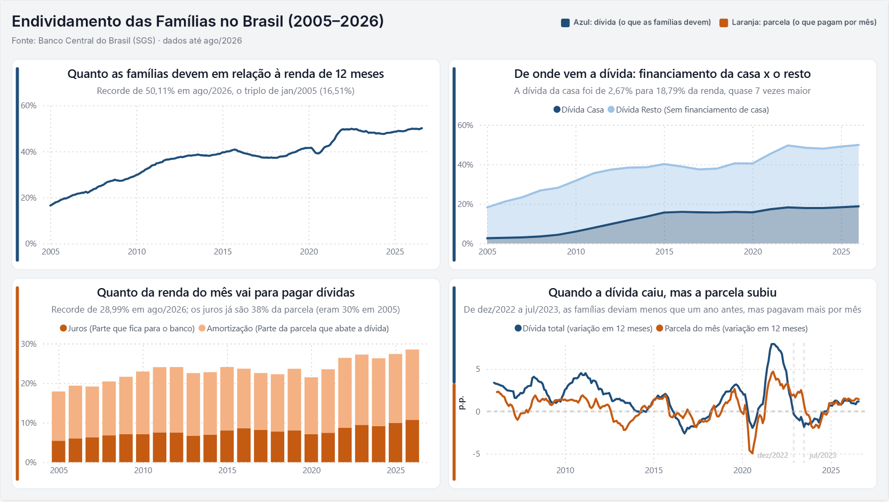

# Endividamento das Famílias no Brasil (2005–2026)

Análise de quanto as famílias brasileiras devem e de quanto da renda delas vai para pagar dívidas, com dados públicos do Banco Central do Brasil.

**Pipeline:** API do Banco Central (SGS) → Python → SQL Server → Power BI



[Ver o dashboard em PDF](imagens/endividamento_familias.pdf)

---

## Perguntas respondidas

### 1. Como o endividamento das famílias evoluiu de 2005 até hoje?
- A dívida das famílias passou de **16,51% da renda de 12 meses** (jan/2005) para **50,11%** (ago/2026), o recorde da série. Ou seja, **triplicou**.
- **Pontos de virada:** 2015 (fim de 10 anos seguidos de alta), 2017 (retomada), jul/2022 (pico de 49,89%) e set/2024 (menor valor após a queda, −1,75 p.p.).
- Os dois picos (jul/2022 e ago/2026) têm endividamento quase igual, mas hoje o comprometimento da renda é **2,49 p.p. maior** (28,99% contra 26,50%).

### 2. Quanto da dívida vem do financiamento da casa?
- A dívida da casa passou de **2,67% da renda** (2005) para **18,79%** (2026): +16,12 p.p., quase **7 vezes maior**.
- Em 2005, a casa era **14,6%** de toda a dívida das famílias. Em 2026, é **37,7%**.
- A participação da casa chegou ao máximo em 2017 (**42,0%** da dívida) e depois recuou: o resto (cartão, veículo, consignado, crédito pessoal) voltou a crescer mais rápido.

### 3. Quanto da renda do mês vai para pagar dívidas?
- O comprometimento passou de **17,00%** (mar/2005) para **28,99%** (ago/2026), o recorde da série: **+11,99 p.p.**
- Os juros ganharam espaço dentro da parcela: eram **29,82%** do que as famílias pagavam em mar/2005 e são **37,67%** em ago/2026.
- Ou seja, uma parte maior do que as famílias pagam fica com o banco, e uma parte menor abate a dívida.

### 4. Houve períodos em que a dívida caiu, mas a parcela subiu?
- Sim. De **dez/2022 a jul/2023** (8 meses seguidos), o endividamento ficou abaixo do mesmo mês do ano anterior (até −1,83 p.p.), enquanto o comprometimento ficou acima (até +2,51 p.p.).
- As famílias deviam menos, mas pagavam mais por mês: um padrão compatível com crédito mais caro ou prazos mais curtos.
- O episódio começa logo depois do pico do endividamento, em jul/2022.

---

## Indicadores utilizados

| Código SGS | Indicador | Uso no projeto |
|---|---|---|
| 29037 | Endividamento das famílias (dívida ÷ renda de 12 meses) | P1, P2, P4 |
| 29038 | Endividamento sem financiamento habitacional | P2 |
| 29034 | Comprometimento de renda (parcela do mês ÷ renda do mês) | P1, P3, P4 |
| 29035 | Comprometimento de renda sem financiamento habitacional | Carregado, não usado nas análises |
| 29036 | Comprometimento de renda com amortização | P3 |
| 21084 | Inadimplência de pessoa física | Carregado para os próximos passos |
| 4189 | Taxa Selic | Carregado para os próximos passos |
| 13522 | IPCA acumulado em 12 meses | Carregado para os próximos passos |

---

## Decisões e cuidados na análise

- **Endividamento ≠ "% de famílias endividadas".** O indicador é o tamanho da dívida em relação à renda, não a quantidade de famílias com dívida.
- **Endividamento e comprometimento medem coisas diferentes.** O primeiro é o saldo total da dívida (comparado à renda de 12 meses). O segundo é o peso da parcela no orçamento do mês.
- **Variações sempre em pontos percentuais (p.p.).** Se o indicador vai de 48% para 50%, a variação é +2 p.p. (e não +2%).
- **Juros é uma estimativa:** comprometimento total (29034) − amortização (29036), porque não há série própria de juros no SGS.
- **Defasagem dos dados:** endividamento e comprometimento são publicados com alguns meses de atraso. Por isso as análises vão até **ago/2026**, embora a Selic já tenha dados até nov/2026.
- **Variação em 12 meses** (P4) é calculada em SQL, comparando cada mês com o mesmo mês do ano anterior (view `vw_variacao_12m`).

---

## Estrutura do repositório

```
endividamento-familias-brasil/
├── python/      # coleta dos dados na API do SGS e carga no SQL Server
├── sql/         # criação do banco, tabelas, procedures, views e perguntas analíticas
├── powerbi/     # dashboard (.pbix)
│   └── design/  # imagem de fundo e tema (.json) do dashboard
├── imagens/     # imagem e PDF do dashboard
├── requirements.txt
└── README.md
```

---

## Como reproduzir

**Pré-requisitos:** SQL Server, ODBC Driver 18 for SQL Server, Python 3 e Power BI Desktop.

1. Clone o repositório e instale as dependências:
   ```bash
   pip install -r requirements.txt
   ```
2. Execute `sql/01_criar_banco.sql` e `sql/02_procedure_carga.sql` para criar o banco `EndividamentoBR`, as tabelas, a procedure de carga e as views.
3. Execute `python/coleta_bcb.py`. Ele busca as séries na API do SGS e carrega os dados no SQL Server.
4. Execute `sql/03_validacao.sql` para conferir a carga e `sql/04_analises.sql` para ver as respostas das perguntas.
5. Abra `powerbi/endividamento_familias.pbix` e atualize a conexão com o seu servidor SQL Server.

---

## Próximos passos

- A Selic alta é acompanhada de comprometimento de renda mais alto? Com quantos meses de atraso?
- A inadimplência de pessoa física acompanha o comprometimento de renda?
- Como os indicadores se comportaram na recessão (2015–2016) e na pandemia (2020–2021)?

---

## Fonte e licença dos dados

Banco Central do Brasil, Sistema Gerenciador de Séries Temporais (SGS), via API pública. Dados extraídos em **10/11/2026**. Os dados abertos do Banco Central são disponibilizados sob a licença **ODbL**.

---

## Autor

**Cassiano Knopf**: [LinkedIn](https://www.linkedin.com/in/cassianoknopf/) · [GitHub](https://github.com/cassianoknopf)
